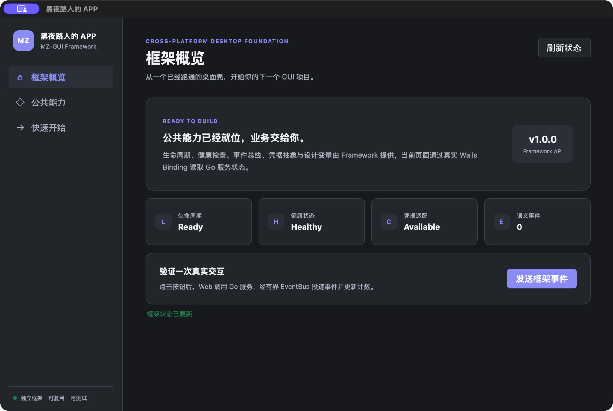
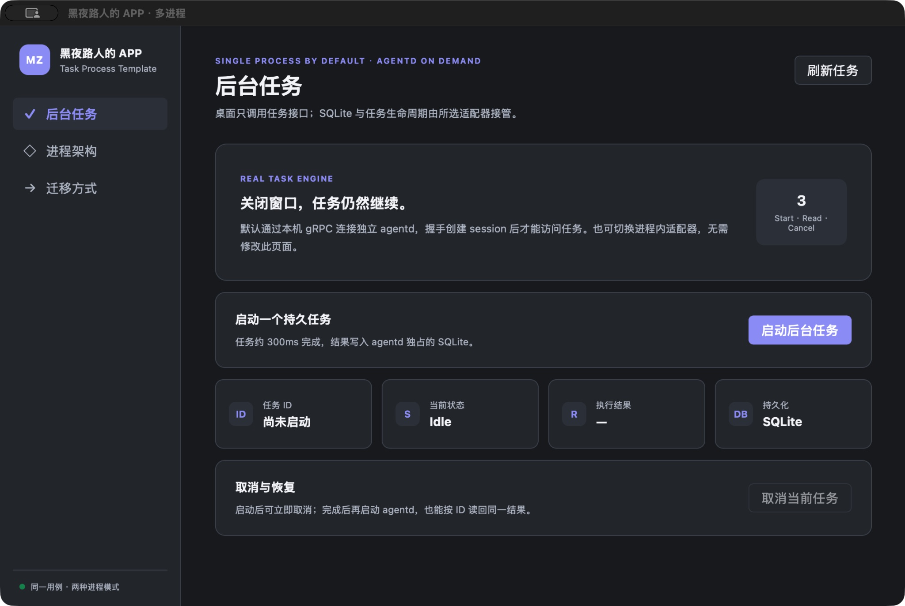
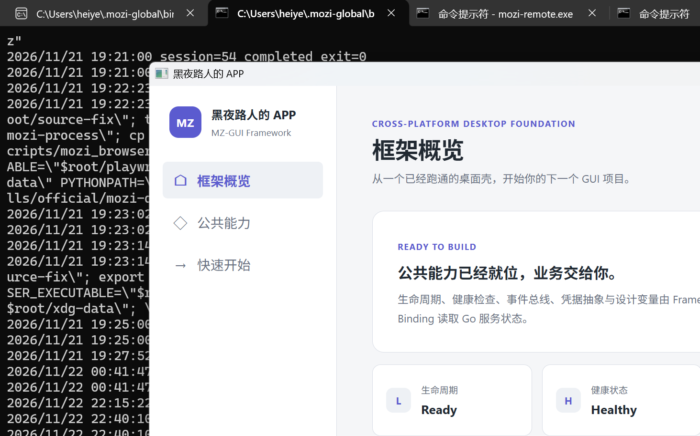
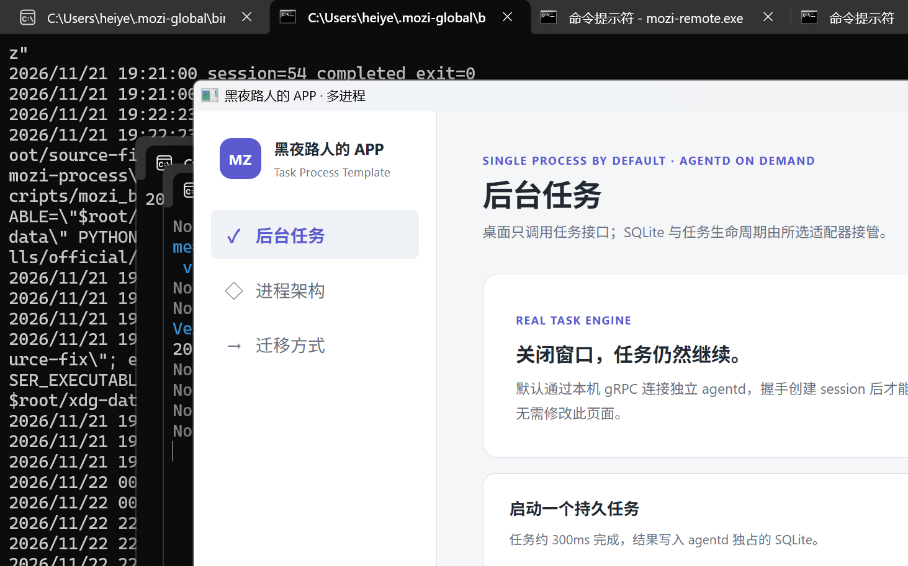

# MZ-GUI

MZ-GUI 是一个可独立运行、可复用的跨平台桌面 GUI 框架，基于 Go、Wails v3、React 和 TypeScript。仓库同时提供公共 Framework、React UI Kit、协议与生成代码、通用工具，以及可直接运行的桌面 APP「黑夜路人的 APP」。

当前发布版本：`v0.0.5`。公共 API 仍包含 `candidate` 和 `experimental` 能力，不将其视为稳定生产承诺。

## 包含能力

- 应用与组件生命周期、健康检查、窗口、托盘和单实例。
- Command / Query / Event、Undo/Redo、快捷键和窗口状态。
- 任务、调度、重试、取消、并发资源、持久进程和跨平台终端。
- Wails、gRPC、Protobuf、流式通信、本机传输和远程协议。
- TOML、SQLite、Blob、配置迁移、系统凭据和文件存储。
- Capability、授权、FileGrant、审计、脱敏和 Web 安全策略。
- 结构化日志、指标、Trace、崩溃诊断和 Testing SDK。
- React Design Token、主题、表单、导航、表格、Markdown、媒体和终端组件。
- 插件、浏览器、媒体、消息总线、对象存储和驱动扩展接口。

## 仓库结构

| 路径 | 内容 |
| --- | --- |
| `framework/go/` | 公共 Go 能力包 |
| `framework/ui-kit/` | 独立 React 组件包 |
| `framework/proto/` | 公共 Protobuf 协议 |
| `framework/api/` | 公共 API 与调用方契约 |
| `framework/capabilities/` | 能力目录与成熟度 |
| `gen/go/mzgui/` | Framework 协议生成代码 |
| `examples/framework-showcase/` | 默认单进程的「黑夜路人的 APP」 |
| `examples/framework-agentd-showcase/` | 同一 UI 与用例的单/多进程任务模板 |
| `examples/framework-plugin-echo/` | Plugin SDK 进程示例 |
| `tools/` | 公共生成、检查、签名与诊断工具 |
| `tests/architecture/` | 独立边界与产品解耦测试 |
| `docs/` | 架构、使用与抽取说明 |

## 直接运行 APP

要求 Go 1.26+。前端使用内嵌静态资源，运行 APP 不需要 npm。

```bash
git clone git@github.com:heiyeluren/mz-gui.git
cd mz-gui
go run ./examples/framework-showcase
```

macOS 可生成标准应用包：

```bash
bash scripts/package-showcase-darwin.sh
open build/MZ-GUI-Showcase.app
```

窗口包含框架概览、公共能力和快速开始。点击「发送框架事件」会完成一次真实的 Wails → Go → EventBus 调用。

## 界面预览

以下是框架自带 APP 的真实 macOS 运行截图，不是设计稿。你可以先看到默认界面，再复制示例开发自己的应用。

<table>
  <tr>
    <td></td>
    <td></td>
  </tr>
  <tr>
    <td align="center">默认单进程：框架概览、健康状态和真实事件</td>
    <td align="center">可选多进程：agentd 后台任务与恢复</td>
  </tr>
  <tr>
    <td></td>
    <td></td>
  </tr>
  <tr>
    <td align="center">Windows 真机：单进程与真实 EventBus</td>
    <td align="center">Windows 真机：Named Pipe 与后台任务</td>
  </tr>
</table>

更多截图说明与复现命令见 [界面参考](docs/screenshots/README.md)。

## 验证与构建

```bash
# 可选：仅在开发 UI Kit 时需要 Node.js 22.12+
npm --prefix framework/ui-kit ci

make test          # Go 全量测试 + UI Kit 测试
make build         # Go 全量构建 + UI Kit ESM/声明文件
make check         # 需求矩阵、生成元数据与架构边界
make package-darwin
```

也可以使用 `task test`、`task build`、`task run`，或直接执行 `go test -p=2 ./...`。

## 在自己的项目中使用

Go module 路径保持不变：

```go
import "github.com/heiyeluren/mz-gui/framework/go/lifecycle"
import "github.com/heiyeluren/mz-gui/framework/go/interaction/eventbus"
```

React UI Kit：

```tsx
import { ModuleRail, ThemeProvider } from '@mz-gui/ui-kit'
import '@mz-gui/ui-kit/styles.css'
```

建议复制 `examples/framework-showcase` 作为新 APP 起点，修改 `mzgui.app.toml` 中的产品名、bundle ID、进程名、存储命名空间和能力集合，再运行 `make generate-app`。不要修改 Framework 来塞入产品业务；在应用组合根注入自己的配置、DTO 和用例。

## 文档

- [快速开始](docs/getting-started.md)
- [架构与依赖边界](docs/architecture.md)
- [单进程与多进程模式](docs/process-models.md)
- [API 版本与兼容策略](docs/api-compatibility.md)
- [Adapter 与插件升级指南](docs/adapters.md)
- [独立抽取范围与兼容策略](docs/framework-extraction.md)

## 验证范围

`v0.0.5` 已在 macOS Apple Silicon 与 Windows amd64 上完成 Go 测试、独立构建、UI Kit 测试、独立消费者、单/多进程真实窗口交互和后台任务恢复验收。macOS Intel 和 Linux 的真机兼容性未在本版本验证；构建成功不等于对应平台已验收。

## 许可证

[Apache License 2.0](LICENSE)
